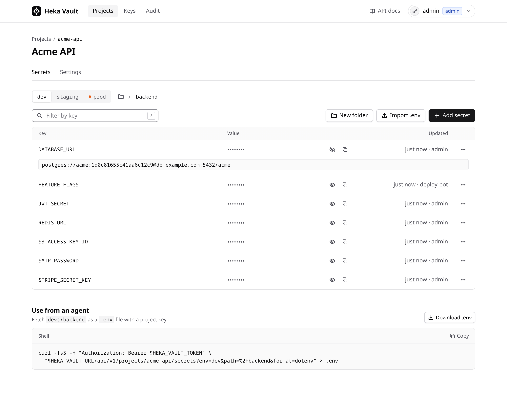
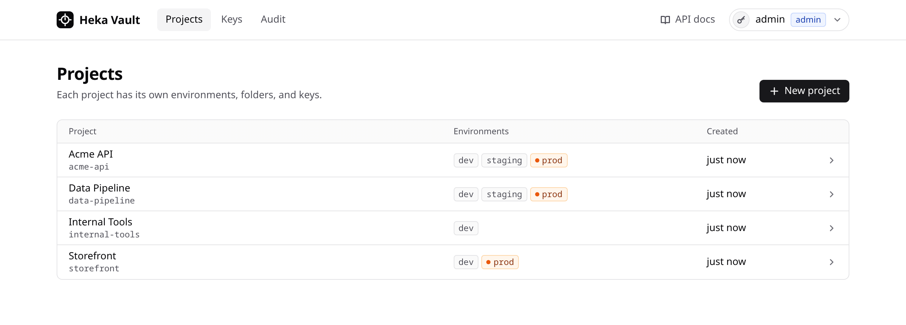
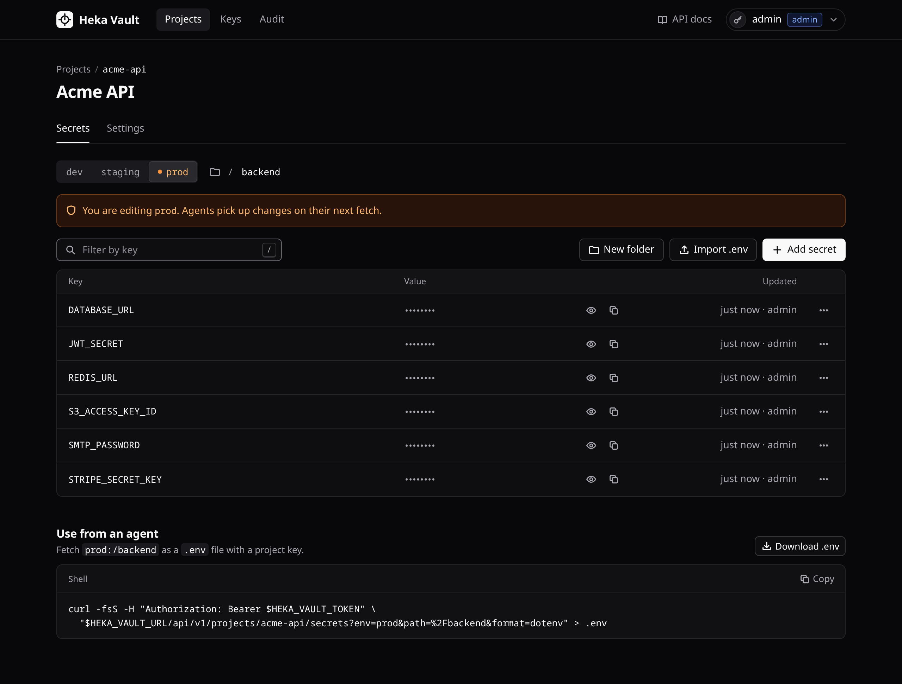
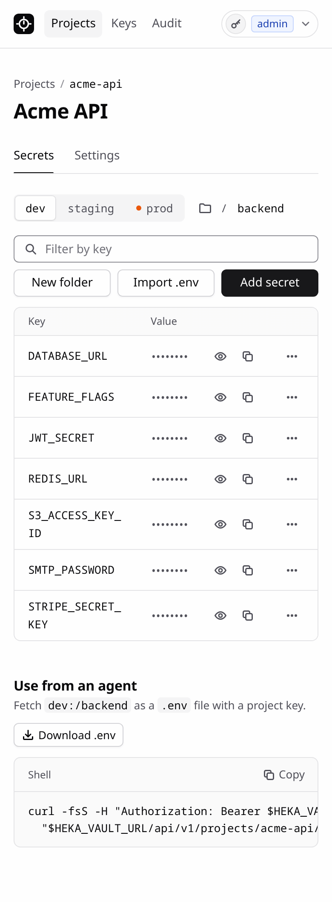
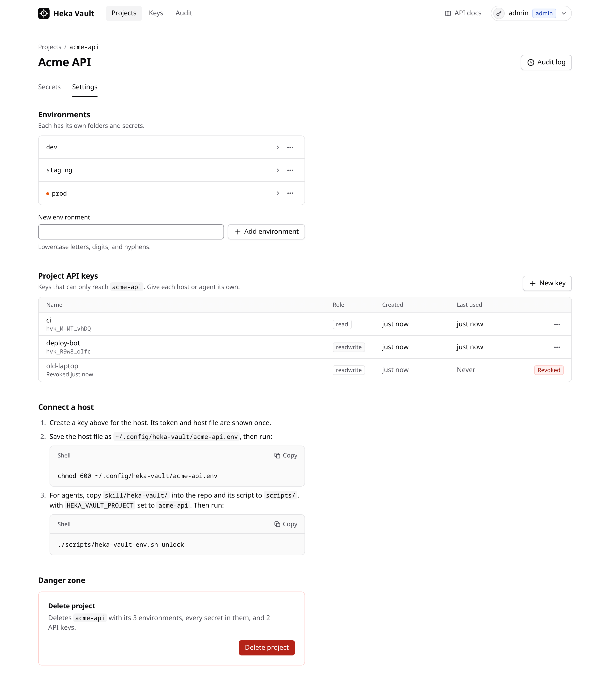
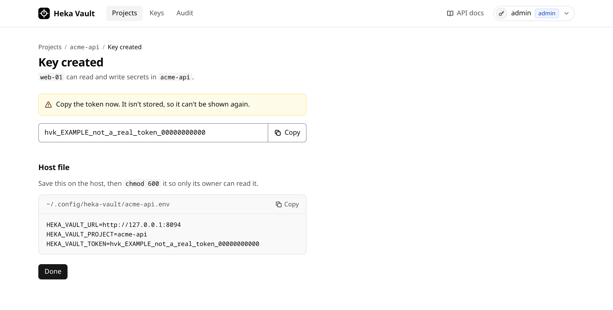
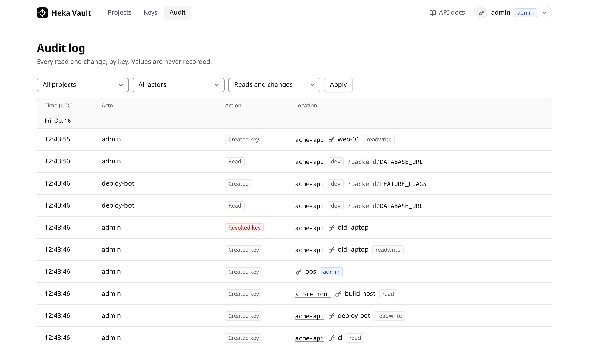

# Heka Vault

A small secrets service for agents on a private network. It has one Deno process, one SQLite file,
an HTTP API, and a server-rendered admin UI. Everything authenticates with API tokens.

It is built for a trusted LAN. There is no TLS, SSO, user accounts, or secret rotation. Don't expose
it to the internet.



## Model

- **Project** → **environments** (`dev`, `staging`, `prod`, …) → **folder paths** (`/`, `/backend`,
  …) → **secrets** (`KEY=value`).
- **API keys** (`hvk_…`) come in three roles:
  - `admin`: everything, including projects, environments, keys, and the audit log.
  - `readwrite`: read and write secrets in one project.
  - `read`: read secrets in one project.
- Secret values are encrypted with AES-256-GCM. The master key lives in a separate file, so a copied
  database is useless without it. Associated data binds each ciphertext to its project, env, path,
  and key.
- Tokens are stored only as SHA-256 hashes, and are shown once when created.
- Reads and writes go to an audit log (who, what, where — never values).

## Run

```bash
deno task dev                      # http://localhost:8090, data in ./data
deno task cli create-admin-key --name me --out ./admin.env
deno task test
deno task check                    # fmt + lint + type-check
```

| Env var                               | Default                                                        |
| ------------------------------------- | -------------------------------------------------------------- |
| `HEKA_VAULT_DB`                       | `./data/vault.db`                                              |
| `HEKA_VAULT_MASTER_KEY_FILE`          | `./data/master.key` (created on first run if no DB exists yet) |
| `HEKA_VAULT_HOST` / `HEKA_VAULT_PORT` | `0.0.0.0` / `8090`                                             |

The server refuses to start if the master key doesn't match the database.

### Docker

```bash
cd deploy
HEKA_VAULT_DATA=/srv/heka-vault/data docker compose up -d --build
docker compose exec vault deno run -A main.ts create-admin-key --name me --out /data/admin.env
```

Back up `vault.db` and `master.key` together. Keep the key out of any off-host copy of the database.

## Use

- Web UI: `/` (sign in with any API token; project keys only see their project). See
  [Web UI](#web-ui).
- Swagger UI: `/docs`; OpenAPI spec: `/api/v1/openapi.json`.
- Agents: copy [`skill/heka-vault/`](skill/heka-vault/) into a repo as
  `.agents/skills/heka-vault-secrets/`, and copy `scripts/heka-vault-env.sh` to `scripts/` with the
  project name and folder maps filled in.

```bash
curl -fsS -H "Authorization: Bearer $HEKA_VAULT_TOKEN" \
  "$HEKA_VAULT_URL/api/v1/projects/myproj/secrets?env=dev&path=/&format=dotenv" > .env
```

## Web UI

Admin keys see every project, plus **Keys** and **Audit**. A `readwrite` key lands on its own
project and can edit secrets; a `read` key gets the same pages with no way to change anything.

**Projects** list each project's environments, with `prod` marked.



**Secrets** are browsed by environment and folder. Values stay masked until you reveal or copy one,
and each of those fetches a single value that is recorded in the audit log as `secret.read`. Writers
can add, edit, and delete secrets, create folders, and import a `.env` file. Anyone can download the
current folder as `.env` or copy the `curl` command an agent would use. `prod` carries a warning
before you edit it.

| Dark theme                                                  | 390px wide                                                                           |
| ----------------------------------------------------------- | ------------------------------------------------------------------------------------ |
|  |  |

**Settings** (admin only) hold the project's environments and keys, the steps to connect a host, and
deleting the project, which asks you to type its slug.



**New keys** show their token once, with the host file to save as
`~/.config/heka-vault/<project>.env`.



**Audit** shows who read or changed what, and where, filtered by project, actor, or action. It never
shows values.



The UI follows the system light or dark setting and works without JavaScript. The screenshots use
made-up data.

## Layout

| Path             | What                                                                                                                         |
| ---------------- | ---------------------------------------------------------------------------------------------------------------------------- |
| `src/vault.ts`   | The domain: schema, encryption, authorization, audit. Every operation takes the calling `Principal`.                         |
| `src/api.ts`     | JSON API under `/api/v1`.                                                                                                    |
| `src/web.tsx`    | Server-rendered UI: auth middleware, error handling, and the feature modules in `src/web/`.                                  |
| `src/web/`       | One module per page (Hono JSX, plain forms); shared shell, styles, and vanilla JS in `layout.tsx`, `styles.ts`, `client.ts`. |
| `src/openapi.ts` | Hand-written OpenAPI 3.1 spec.                                                                                               |
| `src/dotenv.ts`  | `.env` parse/format.                                                                                                         |
| `main.ts`        | Config, `serve`, and `create-admin-key`.                                                                                     |
